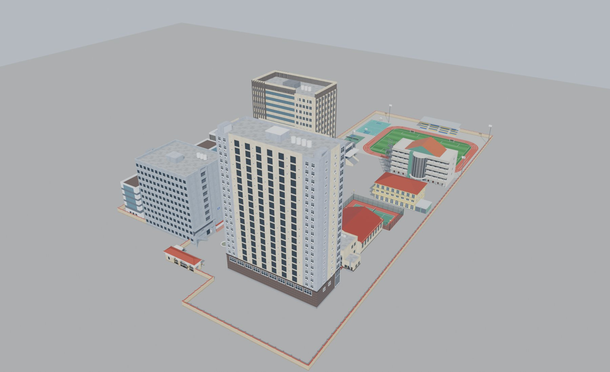

# Model-KMA

Các model 3D low/mid-poly dựng lại cho game Unity (góc nhìn thứ 3).

| Model | Thư mục | Trạng thái |
|---|---|---|
| Cổng trường + nhà bảo vệ + barie + tường bao | [`cong-truong/`](cong-truong/) | v2 |
| Khuôn viên: TA1, TB2, Tòa điều hành + Hội trường, Nhà ăn hệ quân, TA2 + TA3, Canteen, sân tennis, TA4, khu thể thao, bồn nước | [`khuon-vien/`](khuon-vien/) | v1 |

Tất cả dùng chung một hệ toạ độ (gốc = tâm cổng chính, 1 unit = 1 m), kéo vào Unity ở (0, 0, 0) là khớp vị trí.

