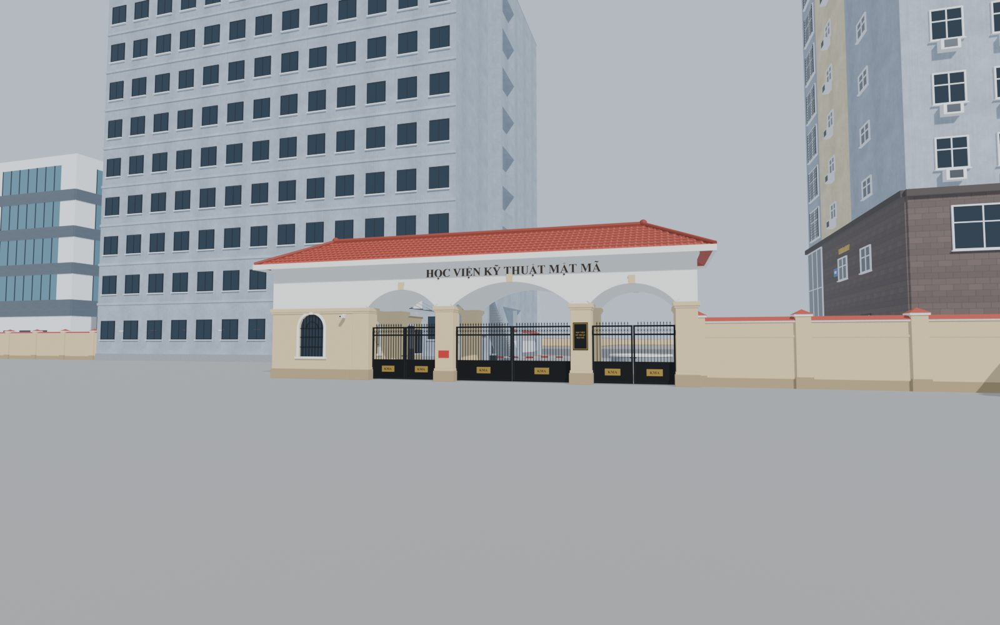
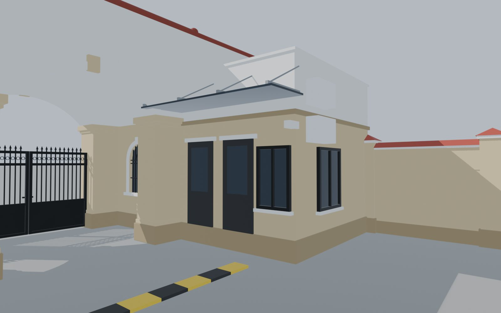
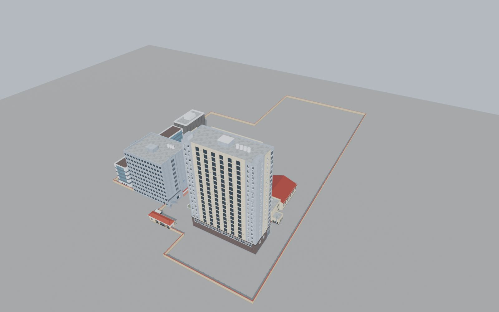

# Cổng trường (v2)

Model cổng chính, nhà bảo vệ, barie lối xe và tường bao quanh khuôn viên, dựng hoàn toàn bằng script Python trong Blender. Dùng cho game Unity góc nhìn thứ 3, cánh cổng mở/đóng được. Toạ độ trùng với mặt bằng khuôn viên (gốc = tâm cổng), nên đặt model ở (0, 0, 0) là khớp với các toà trong [`../khuon-vien/`](../khuon-vien/).

| Từ ngoài đường | Nhà bảo vệ (trong sân nhìn ra) |
|---|---|
|  |  |



## Thay đổi so với v1

- **Nhà bảo vệ:** giữ phần dưới mái cổng, thêm khối mái bằng thò vào sân 3,5 m (chân kem, phần trên trắng tới +4,3 m). Mặt quay ra lối đi có 2 cửa, 1 cửa sổ, mái kính trên giá thép; mặt phía trong có cửa sổ và 2 cục điều hoà.
- **Lối xe:** 2 barie (tủ + cần sọc đỏ trắng), 2 cột camera, gờ giảm tốc vàng đen phía trong cổng.
- **Tường:** bỏ 2 đoạn tường ngắn trước cổng, thay bằng tường bao chạy theo ranh giới khuôn viên (khoảng 760 m), giữ kiểu cũ: thân kem, mũ trắng, ngói đỉnh, cột mỗi 3,6 m.
- Bỏ bản GLB đóng/mở riêng và ảnh render v1.

## Tải về

| File | Dùng để |
|---|---|
| [`export/KMA_Gate.fbx`](export/KMA_Gate.fbx) | Import vào Unity |
| [`unity/KmaGateController.cs`](unity/KmaGateController.cs) | Script đóng/mở cổng |
| [`export/KMA_Gate.glb`](export/KMA_Gate.glb) | Xem nhanh (GitHub hiển thị 3D khi bấm vào file) |
| [`blender/kma_gate.blend`](blender/kma_gate.blend) | File Blender gốc |

## Thông số

- Đơn vị: 1 unit = 1 m. Cổng rộng 14,6 m, nhà bảo vệ 4,2 × 7,5 m, mái cổng cao khoảng 6,6 m, tường cao 2,4 m.
- Khoảng 31 nghìn face (tường bao 5,2 nghìn), màu vật liệu phẳng.
- Object, tất cả là con của `KMA_Gate_Root`:
  - Khối tĩnh: `KMA_Structure`, `KMA_Guardhouse`, `KMA_Roof`, `KMA_Signage`, `KMA_Barriers`, `KMA_Wall`
  - 6 cánh cổng: `KMA_Gate_{L|C|R}_{Left|Right}`, mỗi cánh có pivot đặt đúng trục bản lề

## Dùng trong Unity

1. Copy `KMA_Gate.fbx` và `KmaGateController.cs` vào `Assets/`.
2. Trong Import Settings của FBX, bật **Generate Colliders** để tường, trụ, nhà bảo vệ có va chạm.
3. Kéo model vào scene ở (0, 0, 0), rồi gắn `KmaGateController` vào `KMA_Gate_Root`.
4. Kéo nhân vật vào ô `player`. Trong game, bấm **E** để mở/đóng cổng gần nhân vật nhất. Muốn cổng tự mở khi lại gần thì bật `autoOpen`.

Có thể gọi từ code khác: `OpenAll()`, `CloseAll()`, `Toggle("C")` (`L` / `C` / `R` là vòm trái / giữa / phải).

## Sửa model và build lại

Kích thước nằm trong bảng `P` ở đầu [`scripts/build_kma_gate.py`](scripts/build_kma_gate.py); đường tường bao nằm trong `WALL_PATH` ngay dưới.

```bash
# từ thư mục cong-truong/
blender -b --factory-startup --python scripts/run_build.py            # build lại blender/kma_gate.blend
blender -b blender/kma_gate.blend --python scripts/export_fbx.py       # xuất export/KMA_Gate.fbx
```

Đã chạy thử trên Blender 5.2. Chữ trên cổng dùng font Times New Roman Bold của macOS (`FONT_PATH`); máy khác cần đổi sang một font có dấu tiếng Việt.
