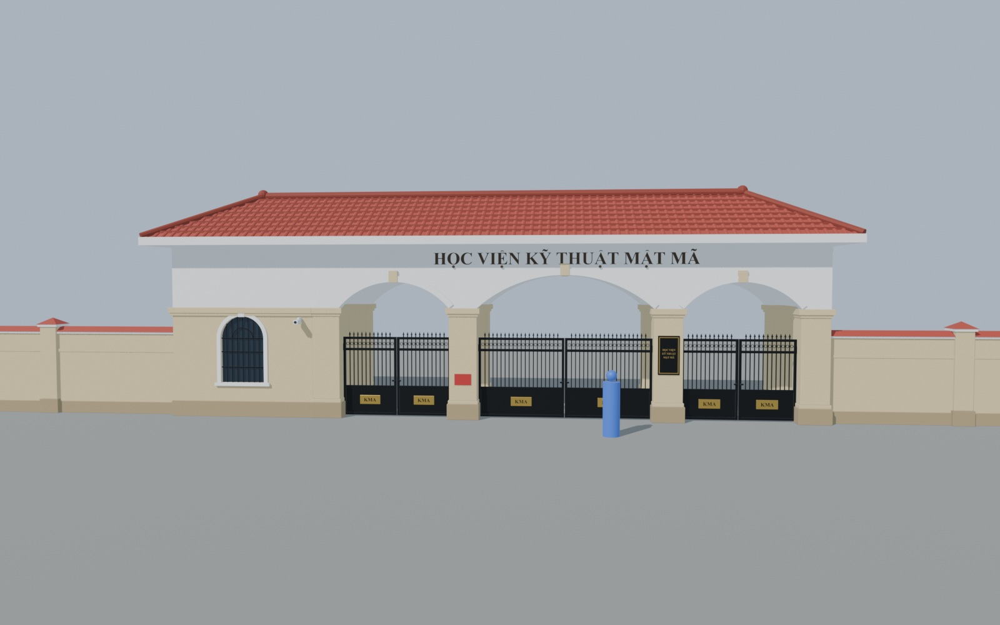
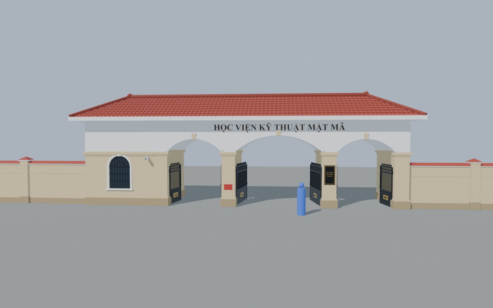
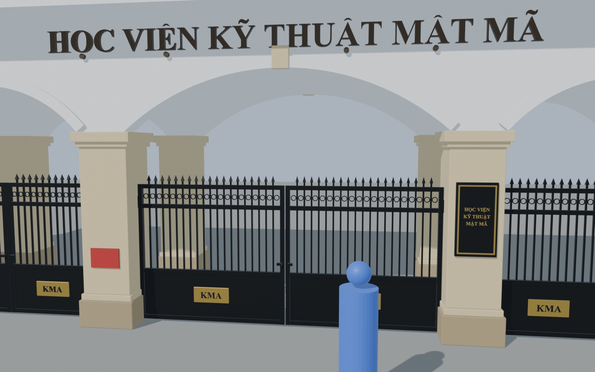
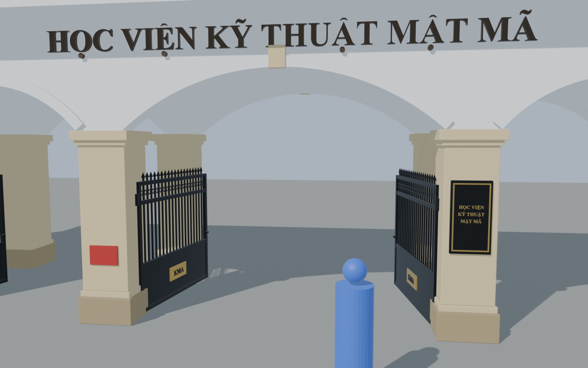

# Cổng trường (v1)

Model cổng chính, nhà bảo vệ và tường rào trước, dựng hoàn toàn bằng script Python trong Blender. Dùng cho game Unity góc nhìn thứ 3, cánh cổng mở/đóng được.

| Cổng đóng | Cổng mở |
|---|---|
|  |  |
|  |  |

Thêm các góc khác ở [`renders/dong/`](renders/dong/) và [`renders/mo/`](renders/mo/). Hình người màu xanh cao 1,7 m chỉ dùng để so tỷ lệ, không có trong model.

## Tải về

| File | Dùng để |
|---|---|
| [`export/KMA_Gate.fbx`](export/KMA_Gate.fbx) | Import vào Unity |
| [`unity/KmaGateController.cs`](unity/KmaGateController.cs) | Script đóng/mở cổng |
| [`export/KMA_Gate_dong.glb`](export/KMA_Gate_dong.glb), [`export/KMA_Gate_mo.glb`](export/KMA_Gate_mo.glb) | Xem nhanh (GitHub hiển thị 3D trực tiếp khi bấm vào file, hoặc mở bằng Preview / 3D Viewer) |
| [`blender/kma_gate.blend`](blender/kma_gate.blend) | File Blender gốc |

Muốn tải cả thư mục: **Code → Download ZIP** ở trang chính của repo.

## Thông số

- Đơn vị: 1 unit = 1 m. Cổng rộng 14,6 m, nhà bảo vệ rộng 4,2 m, mái cao khoảng 6,6 m.
- Khoảng 27 nghìn face, màu vật liệu phẳng (chưa có texture).
- Gồm các object sau, tất cả đều là con của `KMA_Gate_Root`:
  - Khối tĩnh: `KMA_Structure`, `KMA_Guardhouse`, `KMA_Roof`, `KMA_Signage`, `KMA_Wall_Left`, `KMA_Wall_Right`
  - 6 cánh cổng: `KMA_Gate_{L|C|R}_{Left|Right}`, mỗi cánh có pivot đặt đúng trục bản lề

## Dùng trong Unity

1. Copy `KMA_Gate.fbx` và `KmaGateController.cs` vào `Assets/`.
2. Trong Import Settings của FBX, bật **Generate Colliders** để tường và trụ có va chạm.
3. Kéo model vào scene, rồi gắn `KmaGateController` vào `KMA_Gate_Root`.
4. Kéo nhân vật vào ô `player`. Trong game, bấm **E** để mở/đóng cổng gần nhân vật nhất. Muốn cổng tự mở khi lại gần thì bật `autoOpen`.

Script tự xác định chiều mở vào phía trong, và tự thêm BoxCollider cho từng cánh cổng.
Có thể gọi từ code khác: `OpenAll()`, `CloseAll()`, `Toggle("C")` (`L` / `C` / `R` là vòm trái / giữa / phải).

## Sửa model và build lại

Mọi kích thước nằm trong bảng `P` ở đầu file [`scripts/build_kma_gate.py`](scripts/build_kma_gate.py) (độ rộng vòm, chiều cao trụ, độ dốc mái, chiều dài tường...). Sửa xong thì chạy:

```bash
# từ thư mục cong-truong/
blender -b --factory-startup --python scripts/run_build.py            # build lại blender/kma_gate.blend
blender -b blender/kma_gate.blend --python scripts/export_fbx.py       # xuất export/KMA_Gate.fbx
blender -b blender/kma_gate.blend --python scripts/render_preview.py   # render ảnh xem trước vào preview/
```

Script đã chạy thử trên Blender 5.2. Chữ trên cổng dùng font Times New Roman Bold của macOS (`FONT_PATH` trong script). Trên máy khác cần sửa `FONT_PATH` sang một font có dấu tiếng Việt, nếu không chữ có thể bị mất dấu.
