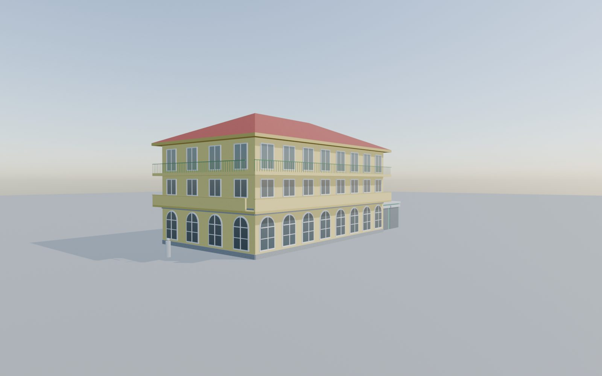
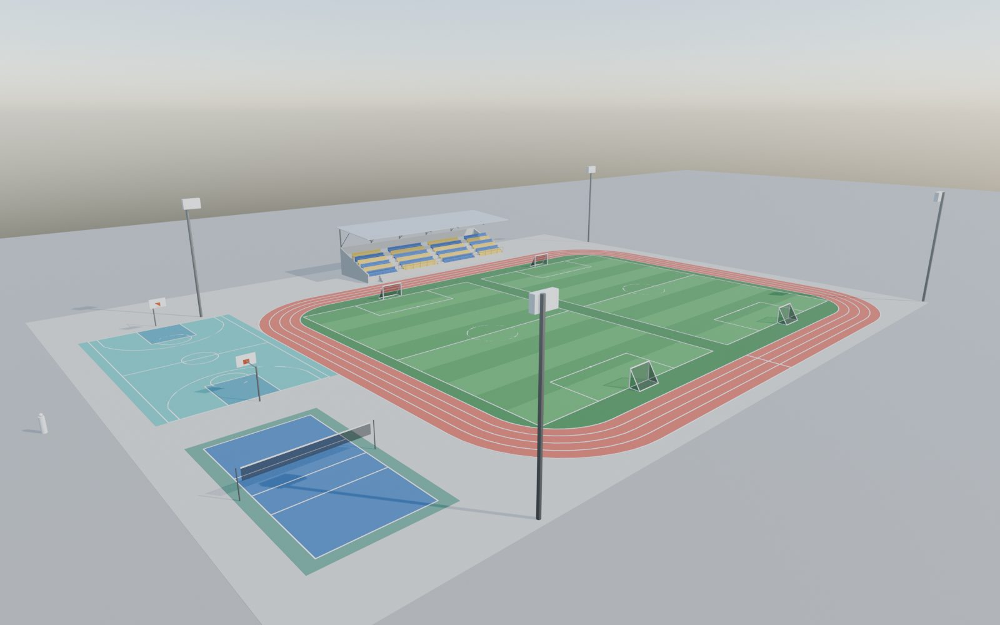
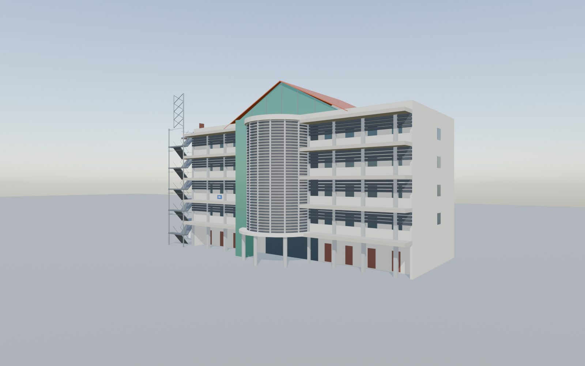
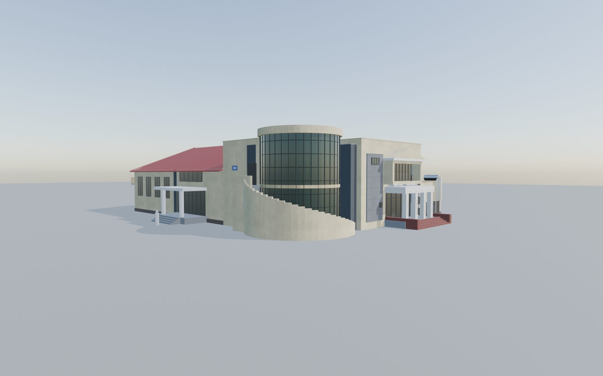

# Khuôn viên Học viện Kỹ thuật Mật mã (v1)

Các toà nhà, sân và công trình trong khuôn viên, dựng bằng script Python trong Blender cho game Unity góc nhìn thứ 3. Mỗi model đã đặt sẵn đúng vị trí trên mặt bằng chung (gốc toạ độ = tâm cổng chính, +Y vào trong trường), nên kéo tất cả vào scene ở (0, 0, 0) là khớp nhau và khớp với cổng ở [`../cong-truong/`](../cong-truong/).


## Danh sách model

| Model | File (FBX cho Unity / GLB xem nhanh) | Mô tả | Face |
|---|---|---|---|
| TA1 | `export/TA1.fbx` · `.glb` | 10 tầng, hành lang lỗ thoáng, cầu thang ngoài | 22 nghìn |
| TB2 (Thư viện, KTX hệ quân) | `export/TB2.fbx` · `.glb` | 20 tầng, đế nâu 2 tầng, chữ THƯ VIỆN / LIBRARY | 59 nghìn |
| Tòa điều hành + Hội trường | `export/HD.fbx` · `.glb` | Tháp 14 tầng, sảnh 2 nấc, khối nối, hội trường | 26 nghìn |
| Nhà ăn hệ quân (biển TB3) | `export/NHA_AN.fbx` · `.glb` | Khối trước 2 tầng sảnh 4 cột, khối kính tròn, nhà ăn mái tôn 2 mái | 4 nghìn |
| TA2 + TA3 | `export/TA23.fbx` · `.glb` | TA2 5 tầng dải kính, TA3 7 tầng bọc lam | 7,8 nghìn |
| Canteen | `export/CANTEEN.fbx` · `.glb` | 3 tầng vòm cuốn, ban công, mái ngói, nhà kho cửa cuốn | 3,7 nghìn |
| Sân tennis | `export/TENNIS.fbx` · `.glb` | Rào lưới bán trong suốt, đèn, mái che + ghế | 0,8 nghìn |
| TA4 (biển TB5) | `export/TA4.fbx` · `.glb` | 5 tầng hành lang bọc lam, khối cong, tháp thang thép | 5,6 nghìn |
| Khu thể thao | `export/SPORTS.fbx` · `.glb` | 2 sân bóng dọc, đường chạy 4 làn, bóng rổ, bóng chuyền, khán đài | 3,4 nghìn |
| Bồn phun nước | `export/FOUNTAIN.fbx` · `.glb` | Ø 5 m trước TA1 | 1,1 nghìn |
| **Toàn bộ** | `export/campus_all.glb` | Tất cả các model trên + cổng, tường | |

Mỗi FBX có kèm một object `<TÊN>_Collider` gồm vài hộp đơn giản để làm va chạm (sân bóng, đường chạy, mặt sân đi lại tự do; lưới tennis và khung thành có collider).

| | |
|---|---|
|  |  |
|  |  |

## Thư mục

| Thư mục | Nội dung |
|---|---|
| `export/` | FBX + GLB từng model, `campus_all.glb` và 2 cụm gộp dùng cho trang web |
| `blender/` | File Blender gốc từng model |
| `layout/` | Thông số: `campus_layout.json` (mặt bằng chung) và `buildings/*.json` (từng toà) |
| `scripts/` | Script vẽ mặt đứng 2D (`draw_elevation_*.py`), dựng 3D (`build_*.py`), render, xuất file gộp |
| `textures/` | Texture tự sinh (sơn, gạch, đá, ngói) dùng khi dựng |
| `renders/` | Mặt bằng, bản vẽ mặt đứng, so sánh 2D – 3D, phối cảnh từng toà |
| `web/` | Trang xem model 3D trên trình duyệt |

## Xem trên trình duyệt

```bash
python3 khuon-vien/web/serve.py 8771     # rồi mở http://127.0.0.1:8771/web/
```

## Dựng lại

Sửa thông số trong `layout/buildings/<toà>.json`, rồi chạy từ thư mục `khuon-vien/`:

```bash
python3 scripts/draw_elevation_<toà>.py                               # vẽ lại mặt đứng 2D
blender -b --factory-startup --python scripts/build_<toà>.py          # dựng lại .blend, xuất FBX + GLB
blender -b --factory-startup --python scripts/export_combo.py -- gate fountain ta1 tb2 hd nha_an ta23 canteen tennis ta4 sports
```

Ảnh chụp thực tế dùng để đối chiếu không đưa lên repo, nên phần render "so sánh với ảnh" trong `render_building.py` sẽ bỏ qua nếu thiếu ảnh. Đã chạy thử trên Blender 5.2.

## Ghi chú

- Mặt có ảnh chụp được dựng theo ảnh; mặt không có ảnh (thường là mặt sau, phía tường rào) dựng theo giả định đã thống nhất, ghi trong `decisions` của từng file JSON.
- Khu thể thao không có ảnh: vị trí theo ảnh vệ tinh, kích thước theo chuẩn sân.
- Chưa dựng: TB1, Phòng y tế, Nhà xe.
